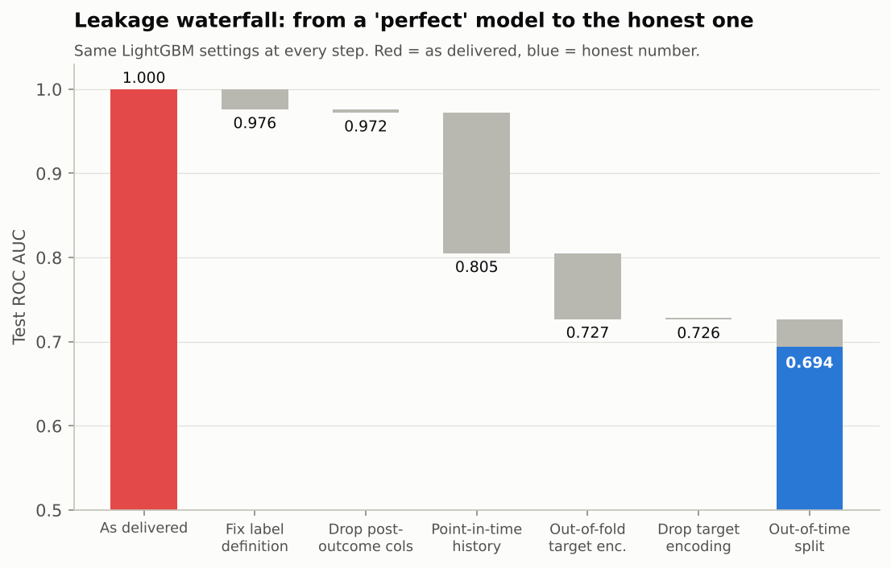
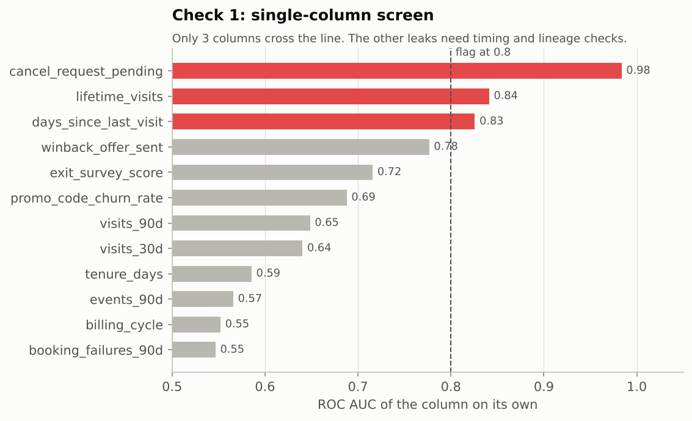

# 1. Leakage audit

The analytics team handed over `member_snapshot_export`: one row per member per
month, a label `churned_next_30d`, and 20 columns. A LightGBM fit on it with a
random split scores **ROC AUC 0.9996**. No churn model is that good.
The audit below finds why, using only checks a reviewer could run without
knowing where the traps are (`src/catcafe/leakage.py`).

## The seven leaky columns and how each was caught

| # | Column | Type | Evidence | Fix |
|---|---|---|---|---|
| L1 | `cancel_request_pending` | Label definition: outcome already decided | Single-column AUC 0.98; 96.7% of positive labels had *already requested* cancellation before the snapshot | Predict the request, not the effective date; drop members with a pending request |
| L2 | `exit_survey_score` | Target leakage: exists only after cancelling | Missing for 77% of non-churners vs 35% of churners; 82% of values were written after the snapshot | Drop. Use it for research, never as a feature |
| L3 | `winback_offer_sent` | Post-outcome treatment | 84% of offers were sent after the snapshot (AUC 0.78 - below the screen's flag) | Drop. The CRM sends it *because* someone cancelled |
| L4 | `lifetime_visits`, `days_since_last_visit` | Time travel: joined from today's member table | 99% / 99% of rows disagree with a point-in-time recompute; 31% of rows claim more days since the last visit than the member had been a member - impossible at snapshot time | Recompute from the event log with `ts < snapshot_date` |
| L4 | `has_adopted_cat` | Time travel (quiet version) | Single-column AUC only 0.54 - invisible to the screen - but 52% of the 1s are adoptions that had not happened yet | Replace with `adopted_cat_90d` / `adopted_cat_ever` as of the snapshot |
| L5 | `promo_code_churn_rate` | Target encoding fitted on all rows incl. test | 3,720 codes, 59% used by one member. AUC 0.69 as delivered vs 0.50 out of fold | Fit encodings inside each training fold - then notice it carries no signal and drop it |
| L6 | (random row split) | Split leakage: same members and future months on both sides | 97% of test rows belong to a member seen in training and 99% of training rows are *later* than the earliest test row | Out-of-time split: train <= Aug-2025, validate Sep/Oct, test Nov/Dec |

The traps are planted by `warehouse.py` the way they usually appear in real
work: not by anyone doing something silly, but by joining a monthly snapshot
to *current-state* tables (member dimension, CRM, exit survey) and by a
reasonable-sounding label ("churned in the next 30 days" - but cancellations
take effect after a 30-day notice, so most of those members had already
decided).

## Why one check is not enough

The single-column AUC screen is the check most people run. It flags only
the three loudest columns. `winback_offer_sent` (0.78) and
`exit_survey_score` (0.72) sit just under any sensible threshold, and
`has_adopted_cat` (0.54) looks like noise. They were caught by asking a
different question: **when was this value written, relative to the snapshot?**
That is the check that generalises - every column needs a known
"available at" timestamp, and anything without one is guilty until proven innocent.

## Waterfall (same model settings at every step)

| Step | Test AUC | Change |
|---|---|---|
| As delivered (all columns, random split) | 1.000 |  |
| Fix label: predict the request, drop pending | 0.976 | -0.024 |
| Drop post-outcome columns (survey, win-back) | 0.972 | -0.004 |
| Recompute history columns point in time | 0.805 | -0.167 |
| Fit target encoding on train folds only | 0.727 | -0.078 |
| ...and since it adds nothing, drop it | 0.726 | -0.000 |
| Out-of-time split (train <= Aug-25, test Nov/Dec-25) | 0.694 | -0.032 |

Reading it honestly:

* The order of fixes changes how much each bar "owns". Dropping the survey and
  win-back columns costs only 0.004 AUC because, by that step, the time-travel
  columns already carried the same information. Each bar is a marginal effect
  given the fixes before it, not a standalone measure of that leak.
* The out-of-time split costs another 0.032. Part of that is member-level
  memorisation in the random split; part is genuine drift (the base grows,
  cafes get more crowded, a price increase happened in July 2025). A random
  split hides both. Production only ever sees the future.
* The honest number with the export's columns is **0.694**. Rebuilding the
  features properly from the event log (`features.py`) gets the model to
  **0.729** - see the model report.

## Split audit

| | Random 80/20 rows | Out-of-time |
|---|---|---|
| Test rows whose member is also in train | 97% | 70% |
| Training rows dated after the earliest test row | 99% | 0% |

Seeing the same member in train and test is fine in the out-of-time setting -
that is the deployment reality: you score existing members. Seeing their
*future* in training is not.

## Checklist to reuse

1. For every column: what event creates it, and is its timestamp strictly before the snapshot?
2. Recompute any "lifetime" or "last X" column from the raw log and diff it.
3. Look for impossible values (last visit before signup, negative tenure).
4. Is the label's outcome already determined at prediction time? Can anyone act on it?
5. Missingness by label. Columns that only exist for one class are outcomes, not features.
6. Any target or frequency encoding: was it fitted on rows that are later evaluated?
7. Split by time; group by entity when rows of one entity span the split.
8. If a simple model beats your expectations by a lot, assume leakage first.
