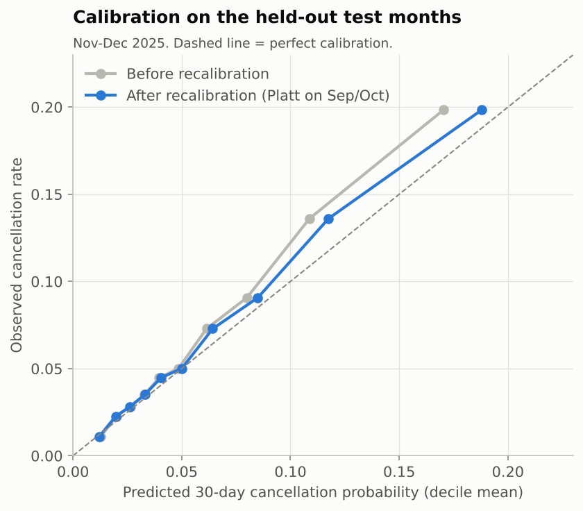
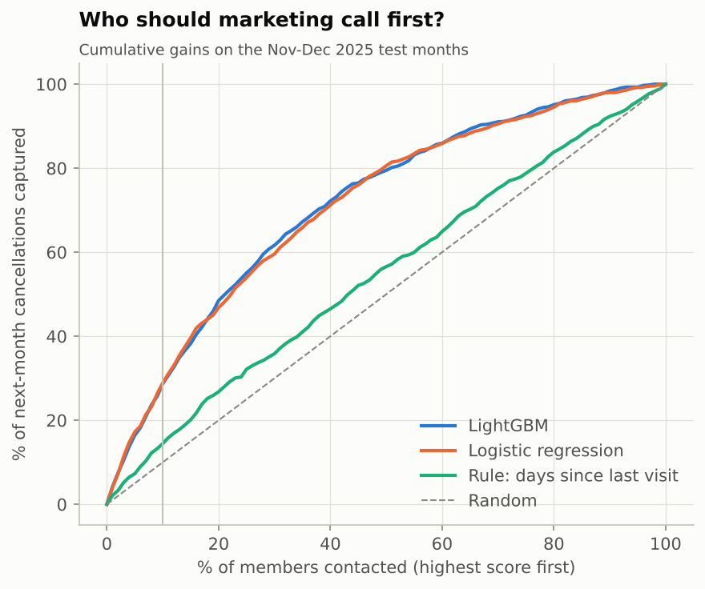
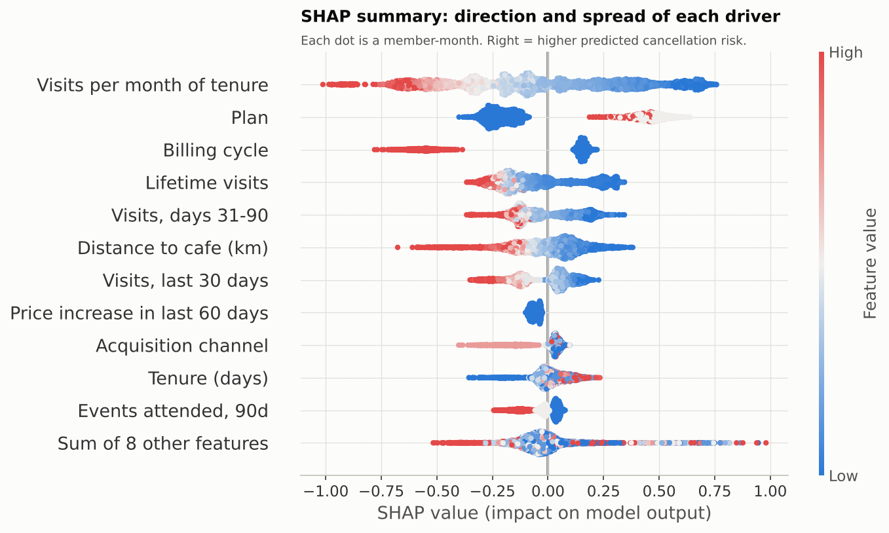
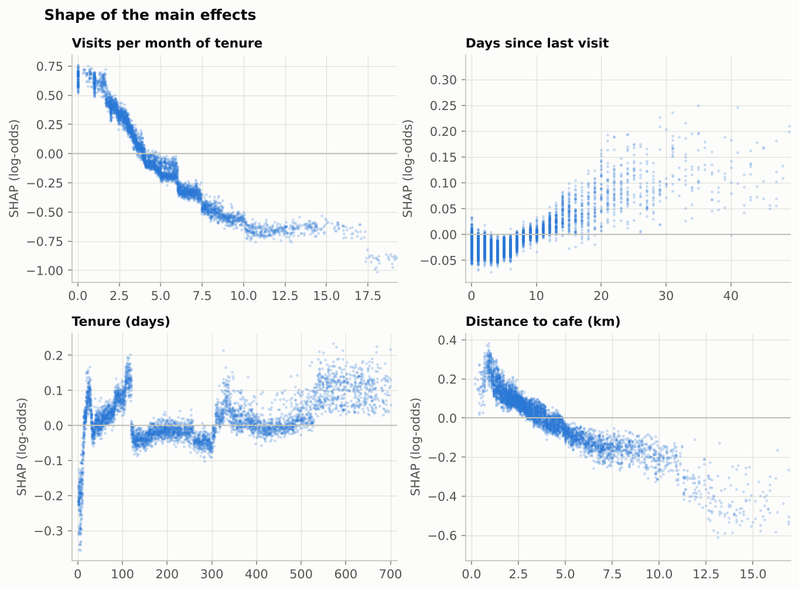
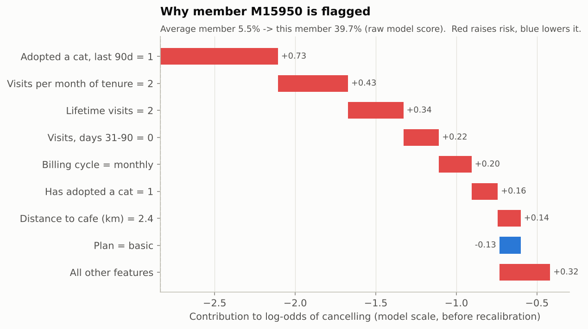

# 2. Churn model and SHAP explanations

**Target:** member submits a cancellation request in the 30 days after the
monthly snapshot. Members with a request already pending are excluded.
**Features:** 19 point-in-time features built from the event log (`features.py`).
**Split:** train 67,384 member-months (Apr-2024 to Aug-2025), validation
13,387 (Sep/Oct, early stopping + calibration), test 14,556 (Nov/Dec, touched once).
Base rate in test: 6.9% per month.

## Results on the held-out months

| Model | ROC AUC | PR AUC | Lift top 10% | Recall top 10% | Brier | Expected / observed |
|---|---|---|---|---|---|---|
| LightGBM + Platt recalibration | 0.729 | 0.168 | 2.88x | 29% | 0.0611 | 0.92 |
| LightGBM, raw scores | 0.729 | 0.168 | 2.88x | 29% | 0.0612 | 0.87 |
| Logistic regression | 0.725 | 0.169 | 2.89x | 29% | 0.0613 | 0.84 |
| Rule: days since last visit | 0.551 | 0.084 | 1.44x | 14% | - | - |
| v1 LightGBM (price level feature) | 0.702 | 0.147 | 2.58x | 26% | 0.0623 | 1.20 |

What this says, without spin:

* **The model is useful, not magic.** Contacting the riskiest 10% of members
  reaches 29% of next month's cancellations, 2.9x random. An AUC around
  0.73 is in the usual range for monthly subscription churn; anything near 0.95 should
  send you back to the leakage audit.
* **LightGBM barely beats logistic regression** (0.729 vs 0.725 AUC, near-identical lift).
  With this data a regularised logistic regression is a perfectly good
  production model and easier to maintain. LightGBM is kept because SHAP
  on trees shows non-linear shapes (below) that are useful for the business story.
* **Calibration matters more than AUC here** because revenue at risk is a *sum
  of probabilities*. Raw scores predicted 0.87x the observed cancellations; after
  Platt scaling on the validation months, 0.92x. The remaining gap means the
  revenue-at-risk figure is, if anything, slightly understated.

## SHAP caught a modelling bug before it shipped

The first version (v1) used `monthly_price` and a persistent "was hit by the
price increase" flag. SHAP ranked monthly price as the **#2 driver**. That made
no sense - price level has almost no effect in the cafe's history - until
splitting its SHAP values by snapshot month showed it: the July 2025 Basic-plan increase (29 -> 35) caused a
two-month spike in cancellations, and the model had learned "$35 members are
risky" *permanently*. On the Nov/Dec test months v1 over-predicted cancellations
by 20%.

v2 encodes the shock as transient (`price_increase_recent`: increase took effect
in the last 60 days) and drops the price level. AUC went from 0.702 to
0.729 and raw calibration from 1.20 to 0.87. This is the most
valuable thing SHAP did in the project: not the pretty chart, the bug report.

## Global drivers (v2)

| Rank | Feature | Mean absolute SHAP (log-odds) |
|---|---|---|
| 1 | Visits per month of tenure | 0.331 |
| 2 | Plan | 0.289 |
| 3 | Billing cycle | 0.255 |
| 4 | Lifetime visits | 0.164 |
| 5 | Visits, days 31-90 | 0.123 |
| 6 | Distance to cafe (km) | 0.114 |
| 7 | Visits, last 30 days | 0.106 |
| 8 | Price increase in last 60 days | 0.061 |
| 9 | Acquisition channel | 0.060 |
| 10 | Tenure (days) | 0.052 |

How to read these, and how not to:

* **Engagement dominates.** Visits per month of tenure is the single strongest
  signal: below ~3 visits a month risk climbs steeply. Days since last visit
  adds risk after roughly two weeks of absence.
* **Billing and plan.** Monthly-billed members carry far more risk than annual.
  That is partly selection (people who prepay a year were already committed),
  so it is *not* evidence that converting someone to annual would retain them.
* **Adopting a cat** multiplies predicted odds by about 1.9x in the 90 days after
  adoption. The cafe's mission succeeding (cats find homes) is a churn driver.
* **Tenure needs to be read with visits-per-month.** Brand-new members get a
  *negative* tenure SHAP because their visits-per-month value already carries
  the "new and not yet engaged" risk. Correlated features split credit; never
  read one SHAP column in isolation.
* **Distance has a conditional effect**: holding visits fixed, members who
  travel further are *less* likely to cancel (they come despite the trip).
* **Booking failures** barely register. Failures scale with how often you try to
  book, so the model cannot separate "crowded cafe" from "engaged member".
  Exit-form reasons tell a different story (see the recommendation). SHAP ranks
  predictive signal, not causal levers.

## Reason codes for the CRM

Every live member gets their top three risk-raising features as plain-English
reason codes (`reports/tables/at_risk_members_top250.csv`). Example for the
riskiest member in the January base:

