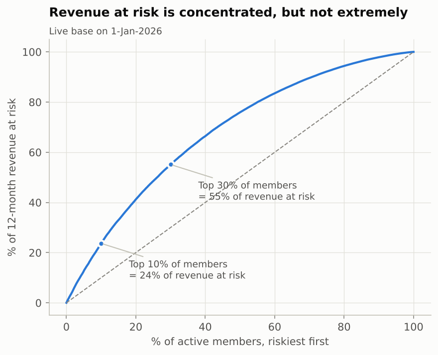
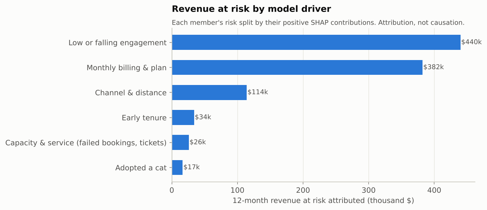

# 3. Revenue at risk

Scored base: **7,794 active members on 1-Jan-2026**, monthly recurring revenue
**$313,968** (annual run-rate $3,767,616).

| Measure | Value | Definition |
|---|---|---|
| MRR at risk, next 30 days | **$21,272** | sum of p(cancel in 30d) x monthly fee |
| 12-month revenue at risk | **$1,013,181** | expected fees lost over 12 months vs. "nobody leaves", constant monthly hazard, 30-day notice |
| As share of annual run-rate | 27% | |
| Held by the riskiest 10% / 30% of members | 24% / 55% | |

Assumptions you should challenge: the 12-month figure keeps each member's
current hazard for a year. New members' hazard falls as they settle in, so
the figure leans high for them; calibration on the test months ran slightly
low (0.92x), which leans the other way. Treat it as a planning range, not a forecast.

## Where the risk sits

| Tenure | Members | Mean p(30d) | MRR at risk (30d) | 12m at risk | Share |
|---|---|---|---|---|---|
| 0-3 mo | 2,083 | 11.4% | $9,844 | $414k | 41% |
| 3-6 mo | 1,407 | 6.3% | $3,592 | $178k | 18% |
| 6-12 mo | 1,988 | 4.7% | $3,955 | $209k | 21% |
| 12+ mo | 2,316 | 4.0% | $3,880 | $212k | 21% |

Members in their first three months are 27% of the base but 41% of revenue at
risk. Monthly-billed members hold 85% of it.

| Risk decile (1 = riskiest) | Members | Mean p(30d) | 12m at risk | Share |
|---|---|---|---|---|
| 1 | 780 | 19.9% | $240k | 24% |
| 2 | 779 | 12.0% | $177k | 18% |
| 3 | 779 | 8.8% | $141k | 14% |
| 4 | 780 | 6.6% | $115k | 11% |
| 5 | 779 | 5.2% | $96k | 9% |
| 6 | 779 | 4.1% | $77k | 8% |
| 7 | 780 | 3.3% | $62k | 6% |
| 8 | 779 | 2.6% | $48k | 5% |
| 9 | 779 | 2.0% | $35k | 3% |
| 10 | 780 | 1.2% | $22k | 2% |

Risk is concentrated, but not enough to make a top-decile campaign a silver
bullet: the riskiest 10% hold under a quarter of the money.

## Revenue at risk by driver

Each member's 12-month risk is split across driver groups in proportion to
their positive SHAP contributions. This is a model attribution - a way of
saying "where does the model see the risk" - not a causal decomposition.

| Driver group | 12m revenue at risk | Share |
|---|---|---|
| Low or falling engagement | $440k | 43% |
| Monthly billing & plan | $382k | 38% |
| Channel & distance | $114k | 11% |
| Early tenure | $34k | 3% |
| Capacity & service (failed bookings, tickets) | $26k | 3% |
| Adopted a cat | $17k | 2% |

## Revenue at risk is not revenue you can save

What can be saved = risk x how much an intervention changes behaviour - what
it costs. The model cannot tell us the middle term. The experiment can.
