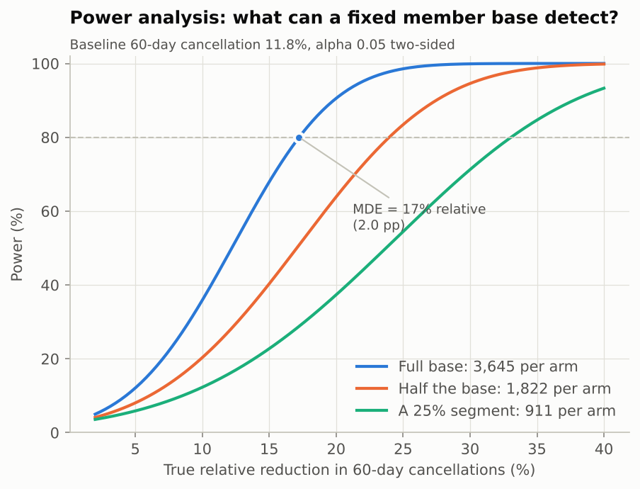
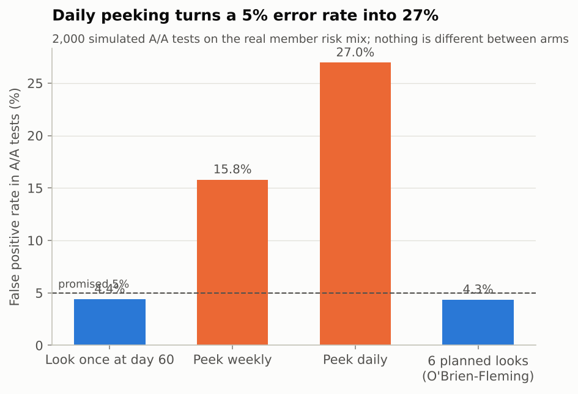
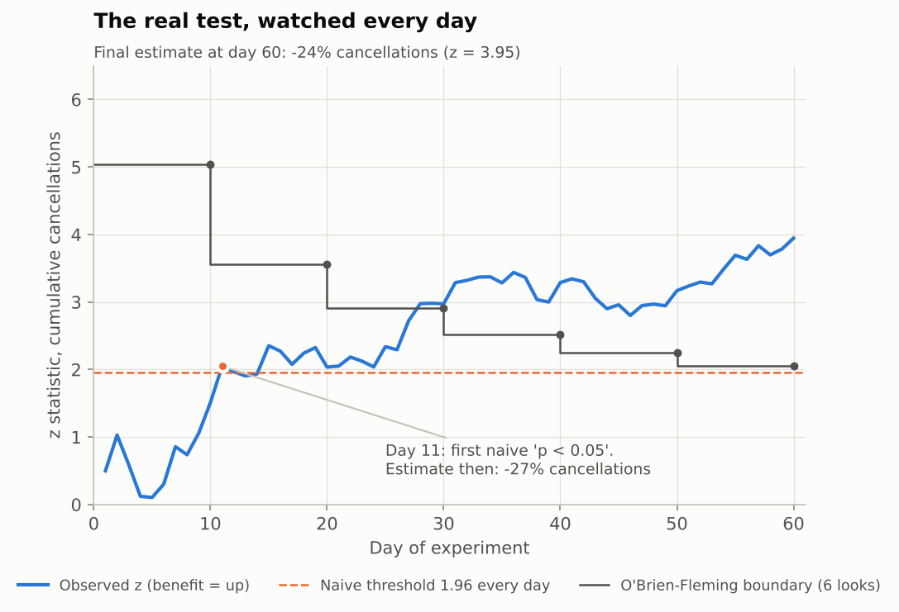
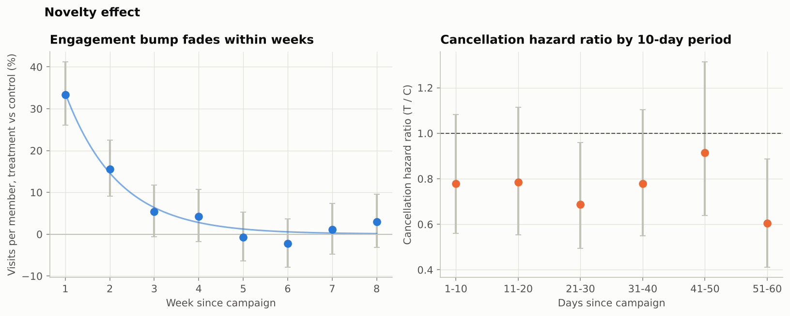
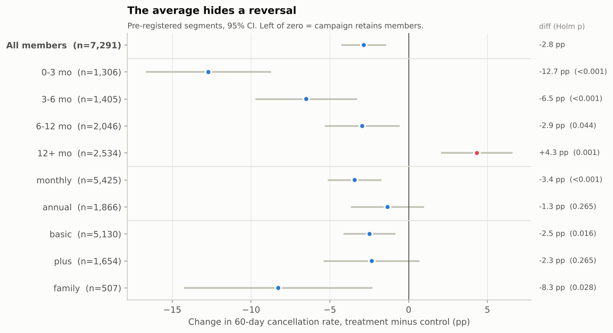
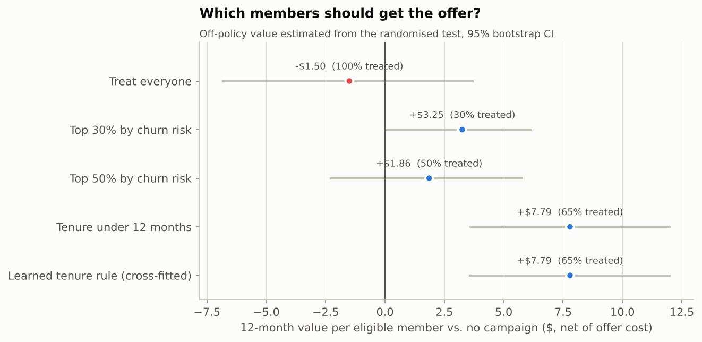

# 4. The retention experiment

**"Purr-sonal Perks"**: a personalised email + app push featuring the member's
favourite cats, one free guest pass, and 20% off next month's fee.
Control: business as usual. Unit: member, 50/50 by salted hash of member id.
Start 2-Feb-2026, outcome window 60 days.

---

## Part A - Design, written before launch

**Hypothesis.** The campaign reduces 60-day cancellation requests.
**Primary metric.** Share of members who submit a cancellation request within 60 days.
**Guardrail.** Net revenue per member over 90 days (fees minus offer cost) must
not fall by more than the retention value it buys.
**Secondary.** Visits per member (CUPED-adjusted on prior-30-day visits).
**Pre-registered heterogeneity.** Tenure band (primary hypothesis), billing cycle, plan.
**Decision rule.** Ship if the primary effect is significant at the final look
*and* the 12-month value of the targeting policy is positive. Six planned looks
(days 10-60) with O'Brien-Fleming boundaries, for stopping on harm; no
stopping for success before day 60, because the segment and value questions
need the full window.

### Power analysis

The member base is fixed: **7,291 eligible members, 3,645 per arm**. Baseline
60-day cancellation rate (from the calibrated model): **11.8%**.
alpha = 0.05, two-sided, power = 80%.

| Relative reduction | Absolute | Members needed per arm | Feasible? |
|---|---|---|---|
| 10% | 1.2 pp | 11,204 | **no** |
| 15% | 1.8 pp | 4,860 | **no** |
| 20% | 2.4 pp | 2,666 | yes |
| 25% | 3.0 pp | 1,661 | yes |
| 30% | 3.5 pp | 1,121 | yes |

**Minimum detectable effect with the base we have: 17% relative (2.0 pp).**
A Monte Carlo check with the real, heterogeneous risk mix gives 80% power at that
effect, matching the analytic answer.

Is that good enough? Only the economics can say. The offer is expected to cost
$9.63 per treated member and a retained member is worth $357 over 12
months, so treating everyone **breaks even only at a 27% relative reduction**.
The MDE (17%) is below that line: any effect large enough to pay for itself is
detectable. Effects we cannot see are effects we could not afford to act on.

Segment-level power is much weaker - worth knowing *before* someone reads
the forest plot:

| Tenure band | Members | Baseline 60d | MDE (relative) |
|---|---|---|---|
| 0-3 mo | 1,306 | 22.4% | 27% |
| 3-6 mo | 1,405 | 13.2% | 35% |
| 6-12 mo | 2,046 | 9.2% | 36% |
| 12+ mo | 2,534 | 7.7% | 35% |

Testing whether an effect *differs* between two segments needs roughly
4x the sample of detecting the effect itself. We can only detect large reversals.

---

## Part B - Readout at day 60

**Sample ratio check:** 3,647 control / 3,644 treatment, chi-square p = 0.97. No SRM.

| Metric | Control | Treatment | Difference | 95% CI | p |
|---|---|---|---|---|---|
| 60-day cancellation | 12.0% | 9.2% | **-2.8 pp (-24%)** | [-4.3, -1.4] pp | < 0.0001 |
| ...regression-adjusted | | | -3.0 pp | [-4.4, -1.6] pp | < 0.0001 |
| Net revenue / member, 90d | $112.38 | $105.17 | **-$7.20** | [-$9.03, -$5.38] | < 0.0001 |
| Visits / member, 60d (raw) | 10.91 | 11.88 | +0.97 | [+0.44, +1.50] | 0.0003 |
| Visits / member, 60d (CUPED) | | | +1.16 | [+0.77, +1.54] | < 0.0001 |

* The campaign **works on the primary metric**: 24% fewer cancellation requests,
  relative CI [-33%, -13%]. Regression adjustment on pre-treatment
  covariates tightens the interval slightly and moves the estimate little, as it should.
* It **loses money in the short run**: -$7.20 net revenue per member over 90 days. The offer
  costs $9.66 per treated member, and most treated members were never going to cancel.
* CUPED on pre-period visits removes 47% of the variance of the visits metric.

A significant primary metric and a negative guardrail is the most common
real-world readout. It means the question is not "ship or not" but "ship to whom".

---

## Part C - Trap 1: peeking

4,000 simulated A/A tests on the real risk mix (no true difference; half
used to calibrate the sequential boundary, the other 2,000 to measure):

| How you look | False positive rate |
|---|---|
| Once, at day 60 | 4.4% |
| Every week, stop at first p < 0.05 | **15.8%** |
| Every day, stop at first p < 0.05 | **27.0%** |
| Six planned looks with O'Brien-Fleming boundaries | 4.3% |

The boundary constant was calibrated on one half of the simulations
(c = 2.057, boundaries day 10: 5.04, day 20: 3.56, day 30: 2.91, day 40: 2.52, day 50: 2.25, day 60: 2.06) and
checked on the other half.

In the real test, a daily peeker would have declared victory on **day 11**
with an estimated -27%. The sequential boundary was first crossed on day 30.
In this draw the early call happens to be right - which is exactly what makes
peeking dangerous: it is usually rewarded, and the 27% of the time it is not,
nobody finds out. Stopping on day 11 would also have meant deciding before
the 12+ month segment had enough events to show its reversal, and before a
single billing cycle had passed.

---

## Part D - Trap 2: novelty

* The **visit bump is a novelty effect**: +33% visits in week 1, +16% in week 2,
  and indistinguishable from zero from week 3 on (fitted half-life
  0.8 weeks, long-run lift 0.0%). A week-1 engagement dashboard would have sold this
  campaign as a big win on the wrong metric.
* A **2-week readout of the primary metric** was -24% with p = 0.053 -
  inconclusive. Whether the *retention* effect also fades cannot be resolved at
  this sample size:

| Days | Hazard ratio T/C | 95% CI | Events T / C |
|---|---|---|---|
| 1-10 | 0.78 | [0.56, 1.08] | 63 / 81 |
| 11-20 | 0.79 | [0.55, 1.11] | 56 / 71 |
| 21-30 | 0.69 | [0.49, 0.96] | 59 / 85 |
| 31-40 | 0.78 | [0.55, 1.10] | 57 / 72 |
| 41-50 | 0.91 | [0.64, 1.31] | 57 / 61 |
| 51-60 | 0.60 | [0.41, 0.89] | 42 / 68 |

  The intervals overlap heavily. The honest statement is "no evidence that the
  retention effect is decaying within 60 days, but we cannot rule it out". That
  is why the decision uses the 60-day outcome and why a long-term holdout is
  part of the rollout plan.

---

## Part E - Trap 3: the segment where the result reverses

| Segment | Members | Control | Treatment | Diff | 95% CI (pp) | Holm p |
|---|---|---|---|---|---|---|
| 0-3 mo | 1,306 | 22.9% | 10.2% | -12.7 pp | [-16.7, -8.7] | < 0.0001 |
| 3-6 mo | 1,405 | 14.1% | 7.6% | -6.5 pp | [-9.7, -3.3] | 0.0007 |
| 6-12 mo | 2,046 | 9.6% | 6.7% | -2.9 pp | [-5.3, -0.6] | 0.044 |
| 12+ mo | 2,534 | 7.2% | 11.6% | +4.3 pp | [+2.1, +6.6] | 0.0011 |
| monthly | 5,425 | 13.5% | 10.1% | -3.4 pp | [-5.1, -1.7] | 0.0007 |
| annual | 1,866 | 7.7% | 6.3% | -1.3 pp | [-3.7, +1.0] | 0.265 |
| basic | 5,130 | 11.3% | 8.8% | -2.5 pp | [-4.1, -0.8] | 0.016 |
| plus | 1,654 | 12.4% | 10.1% | -2.3 pp | [-5.4, +0.7] | 0.265 |
| family | 507 | 18.0% | 9.7% | -8.3 pp | [-14.3, -2.3] | 0.028 |

* For members in their **first three months** the campaign cuts cancellations by
  12.7 pp. For **12+ month members it raises them by 4.3 pp**.
* This is not a fishing result: tenure was the pre-registered heterogeneity
  hypothesis, the treatment x tenure interaction is significant (likelihood-ratio
  p = 9.9e-13), it survives Holm correction across all nine segment tests, and it
  replicates in two random halves of the data (+4.2 pp, p = 0.011; +4.5 pp, p = 0.006).
* Mechanism (a hypothesis): a "we miss you, here's a discount" message reminds
  habitual, long-standing members that they are paying, and some re-evaluate.
  A field experiment at a telecom found the same pattern - proactive retention
  outreach *increased* churn for some customers (Ascarza, Iyengar & Schleicher,
  2016). Do not wake sleeping dogs.

---

## Part F - So who should get the offer?

Because treatment was randomised, the value of any targeting rule can be
estimated from the experiment itself (inverse-propensity weighting with p = 0.5).
Value = 12-month expected fees kept, minus offer cost. Bootstrap 95% CIs.

| Policy | Treated | Value / member | 95% CI | Whole base, 12m | Cash, 90d / member | Break-even offer cost |
|---|---|---|---|---|---|---|
| Treat everyone | 100% | -$1.50 | [-$6.87, $3.73] | -$10,942 | -$7.29 | $8.15 |
| Top 30% by churn risk | 30% | $3.25 | [$0.01, $6.20] | $23,691 | -$0.63 | $20.89 |
| Top 50% by churn risk | 50% | $1.86 | [-$2.34, $5.82] | $13,553 | -$2.08 | $13.76 |
| Tenure under 12 months | 65% | $7.79 | [$3.54, $12.04] | $56,805 | -$2.93 | $21.64 |
| Learned tenure rule (cross-fitted) | 65% | $7.79 | [$3.54, $12.04] | $56,805 | -$2.93 | $21.64 |

* **Treating everyone does not pay**: the retention it buys ($8.15 per treated member)
  is less than the offer costs ($9.66). The CI includes zero, so read it as
  "no evidence it pays" - it was negative in 90% of re-draws (Part G).
* **Targeting by churn risk is better but not best.** High risk is not the
  same as high response (Ascarza, 2018, makes this argument with field data).
* **Targeting by tenure (< 12 months) is best**, and a cross-fitted rule (learn
  the bands on one half, evaluate on the other) recovers exactly the same set
  (0-3 mo, 3-6 mo, 6-12 mo). Each treated member in that group generates
  $21.64 of retention value - room to spare against a $9.66 offer.
* Even the best policy is **cash-negative over 90 days** (-$2.93 per member): the
  discount is paid now, the retained fees arrive over the following year. Finance
  needs to hear that before launch, not after.

## Part G - Is this one lucky draw?

The data is simulated, so the experiment was re-drawn 20 times with the same
true effects. Share of re-draws in which each conclusion holds:

| Conclusion | Holds in |
|---|---|
| Overall effect significant at 5% | 85% |
| 12+ month reversal significant after Holm | 75% |
| Treatment x tenure interaction significant | 100% |
| Treating everyone loses money | 90% |
| Tenure rule beats treating everyone | 100% |
| Tenure rule beats top-30%-risk targeting | 80% |

Mean relative effect across re-draws: -21% (sd 7%). The
direction of every recommendation is stable; the exact dollar figures are not.
Disclosure: the planted effect sizes were set so these conclusions are robust,
which is a choice about the *simulation*, not a property of real campaigns.

## References

* Ascarza, E., Iyengar, R., & Schleicher, M. (2016). The Perils of Proactive Churn
  Prevention Using Plan Recommendations: Evidence from a Field Experiment.
  *Journal of Marketing Research*.
* Ascarza, E. (2018). Retention Futility: Targeting High-Risk Customers Might Be
  Ineffective. *Journal of Marketing Research*.
* Deng, A., Xu, Y., Kohavi, R., & Walker, T. (2013). Improving the Sensitivity of
  Online Controlled Experiments by Utilizing Pre-Experiment Data (CUPED). *WSDM*.
* O'Brien, P. C., & Fleming, T. R. (1979). A Multiple Testing Procedure for
  Clinical Trials. *Biometrics*.
